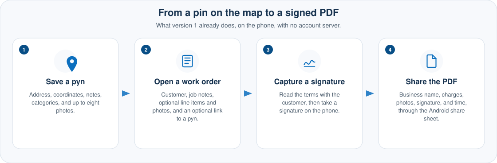
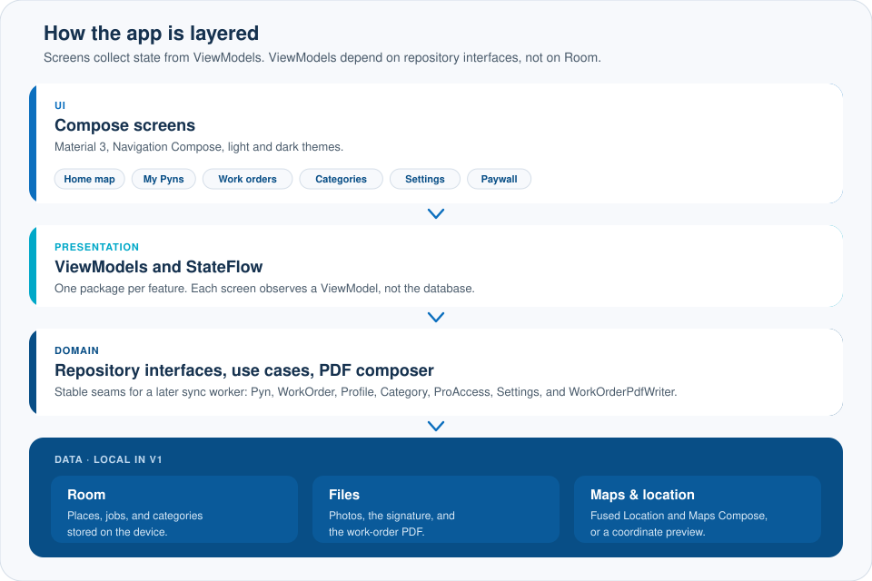
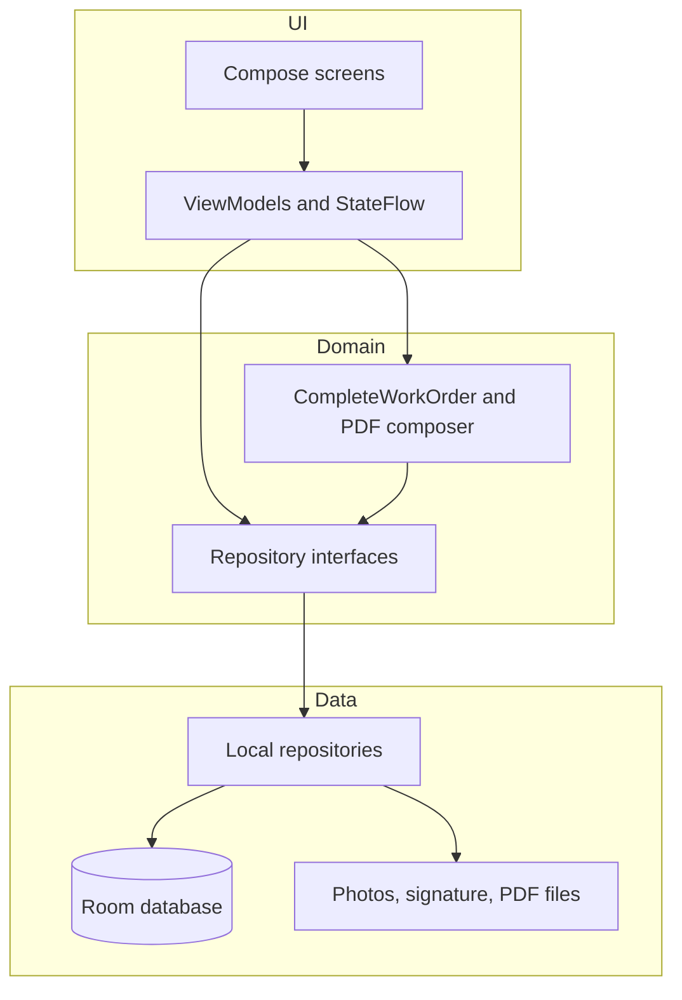

<p align="center">
  
  
</p>

<p align="center">
  <strong>A place notebook for people who work in the field, with work orders that end in a signed PDF.</strong>
</p>

<p align="center">
  Local-first Android. Everything stays on the phone.
</p>

<p align="center">
  <a href="https://github.com/TeebooTed/pushpyns/actions/workflows/android.yml"></a>
  <a href="LICENSE"></a>
  
  
  
  <a href="CONTRIBUTING.md"></a>
  <a href="https://github.com/TeebooTed/pushpyns/issues?q=is%3Aissue+is%3Aopen+label%3A%22good+first+issue%22"></a>
</p>

## Contents

- [Why it exists](#why-it-exists)
- [Features](#features)
- [Screenshots](#screenshots)
- [Architecture](#architecture)
- [Quick start](#quick-start)
- [Contribute in 60 seconds](#contribute-in-60-seconds)
- [Tech stack](#tech-stack)
- [Project structure](#project-structure)
- [Roadmap](#roadmap)
- [FAQ](#faq)
- [Contributing](#contributing)
- [License](#license)
- [Acknowledgments](#acknowledgments)

## Why it exists

Pushpyns started in 2016 as a small Android and iOS idea: save a place, share it, and, for a field business, close the job with the customer's signature. The original service is gone. This repository is that idea rebuilt as a modern, open-source Android app.

Version 1 keeps everything on the phone. The data layer is shaped so cloud sync, accounts, and Play Billing can land later without throwing the screens away.

A **pyn** is a saved place. A **work order** is a job at a place. Pro, for now, is a local preview switch, not a charge.

## Features

<p align="center">
  
</p>

- **Local profile.** Your name, an optional business name, and whether you use the app for personal places, field work, or both. No account server.
- **Home map on the current location.** With no Google Maps key, a coordinate preview still plots your pyns. With a key, the same screen is a Google map.
- **Pyns** with address, coordinates, notes, categories, and up to eight photos from the camera or the gallery.
- **Your own categories**, plus a starter set: Business, Personal, Dining, Camping, Hiking, and Work site.
- **Search**, and sort by category, name, date, or distance.
- **Share a pyn** as text, or hand the coordinates to Google Maps for directions.
- **Work orders:** customer, address, notes, optional line items and photos, and an optional link to a pyn. You can also save the job's address as a new pyn.
- **Close a job** by reading terms, capturing a signature, and sharing a PDF (business name, job, charges, photos, signature, and time) through the Android share sheet.
- **Material 3** light and dark themes, with an optional dynamic-color switch. The default palette stays Pushpyns blue.
- **Load sample places** drops four public demo spots on the map so a fresh install is not empty.
- **Pro preview** is a switch stored on this device. It is not a purchase, and nothing is billed.

## Screenshots

Real captures are not in the repo yet. Please do not substitute mockups or generated pictures — [issue #10](https://github.com/TeebooTed/pushpyns/issues/10) is the call for help.

The diagrams above are architecture and feature overviews, not pictures of the running app.

| Screen | What you would see | Status |
| --- | --- | --- |
| Home map | Current address, preview or Google map, nearby pyns, **New pyn here** | Help wanted |
| Pyn list | Search, sort chips, expandable rows | Help wanted |
| Pyn detail | Map header, address, share, Get Directions | Help wanted |
| New pyn | Form, category chips, camera and gallery | Help wanted |
| Work order | Customer, address, line items, photos, link to a pyn | Help wanted |
| Signature | Terms checkbox, then the signature pad | Help wanted |
| Signed PDF | Completed summary and **Share PDF** | Help wanted |

To contribute shots: run the debug build on an emulator or a device, capture those seven screens, and put the PNGs in [`docs/images/`](docs/images/). See [good first issue #10](https://github.com/TeebooTed/pushpyns/issues/10) and the write-up in [docs/GOOD_FIRST_ISSUES.md](docs/GOOD_FIRST_ISSUES.md).

## Architecture

<p align="center">
  
</p>

Screens collect state from ViewModels. ViewModels depend on repository interfaces, not on Room. The current implementations are local. A sync worker can implement the same interfaces later.

The seams to keep stable are `PynRepository`, `WorkOrderRepository`, `ProfileRepository`, `CategoryRepository`, `ProAccess`, and `SettingsRepository` in [`app/src/main/java/com/pushpyns/domain/repository/Repositories.kt`](app/src/main/java/com/pushpyns/domain/repository/Repositories.kt), plus `WorkOrderPdfWriter` in [`app/src/main/java/com/pushpyns/domain/pdf/WorkOrderPdfWriter.kt`](app/src/main/java/com/pushpyns/domain/pdf/WorkOrderPdfWriter.kt).

<details>
<summary>The same picture as a Mermaid diagram</summary>



</details>

## Quick start

Requirements: JDK 21, Android Studio (current stable), and Android SDK platform 37.2.

```bash
git clone https://github.com/TeebooTed/pushpyns.git
cd pushpyns
```

Open the project root in Android Studio and let it use the Gradle wrapper.

A Maps key is optional. To enable the live map, add this to `local.properties` (that file is gitignored; do not commit it):

```properties
MAPS_API_KEY=your_key_here
sdk.dir=/path/to/Android/sdk
```

[`secrets.defaults.properties`](secrets.defaults.properties) sets `MAPS_API_KEY=MISSING`, which the app treats as "no key" and shows the preview map.

```bash
./gradlew assembleDebug
./gradlew test
./gradlew ktlintCheck
```

Install the debug build on a device or emulator running API 26 or newer:

```bash
./gradlew installDebug
```

Or sideload `app/build/outputs/apk/debug/app-debug.apk`.

On first launch, enter your name. Work orders stay behind **Enable Pro preview** until you turn that on in the paywall or in Settings. The switch is stored on the device. It is not a purchase.

## Contribute in 60 seconds

Issues and pull requests are welcome. This is the shortest path from a first visit to a PR:

1. Pick a starter task from the [good first issues](https://github.com/TeebooTed/pushpyns/issues?q=is%3Aissue+is%3Aopen+label%3A%22good+first+issue%22) and comment on it so two people do not grab the same one. Each task lists the files to open in [docs/GOOD_FIRST_ISSUES.md](docs/GOOD_FIRST_ISSUES.md).
2. Fork the repo and branch from `main`.
3. Make a focused change.
4. Run `./gradlew assembleDebug test ktlintCheck`.
5. Open a pull request against `main`, fill in the template, and link the issue with `Fixes #123` when the PR fully addresses it.

GitHub Actions runs that same Gradle command on every push and pull request. Read [CONTRIBUTING.md](CONTRIBUTING.md) for style, tests, and what we will not take as a surprise PR.

## Tech stack

| Piece | Choice |
| --- | --- |
| Language | Kotlin 2.4.21 |
| UI | Jetpack Compose (BOM 2026.09), Material 3, Navigation Compose |
| State | ViewModel + StateFlow |
| Storage | Room, plus DataStore for theme and dynamic-color settings |
| DI | Hilt |
| Images | Coil |
| Maps | Maps Compose, key from the secrets Gradle plugin |
| Location | Fused Location Provider |
| PDF | `android.graphics.pdf.PdfDocument` |
| Style | ktlint, Android Studio code style |
| Tests | 18 unit and Compose UI tests in `app/src/test` (JUnit, Robolectric, Truth, Turbine) |
| SDK | minSdk 26, compileSdk / targetSdk 37 (platform 37.2) |
| Build | JDK 21, Gradle wrapper, Android Gradle Plugin 9.5.1 |

Exact version pins live in [`gradle/libs.versions.toml`](gradle/libs.versions.toml).

## Project structure

One Gradle module, `:app`, on purpose. Split it when a second client (web, iOS) shares the domain module.

<details>
<summary>Expand the source tree</summary>

```
app/src/main/java/com/pushpyns/
  domain/        models, repository interfaces, distance, money, PDF content
    geo/         distance, addresses, search, and sort
    model/       Pyn, WorkOrder, Profile, Category
    money/       line totals
    pdf/         composer and WorkOrderPdfWriter
    repository/  Pyn, WorkOrder, Profile, Category, ProAccess, Settings
    sample/      four public demo places
    share/       pyn share text
    terms/       terms copy
    time/        date formatting
    validation/  form validators
    work/        CompleteWorkOrder
  data/
    local/       Room database, entities, DAOs
    location/    Fused Location Provider
    mapper/      entity to domain
    media/       photos, signatures, PDF files
    pdf/         PdfDocument writer
    repository/  local implementations, DataStore settings
  ui/            Compose screens and ViewModels, one package per feature
    home/ pyns/ work/ categories/ profile/ settings/ paywall/
    components/  map, signature pad, brand mark
    navigation/  NavHost and drawer
    theme/       Pushpyns blue, light and dark
  di/            Hilt modules
app/src/test/    unit tests and Compose tests (Robolectric)
```

</details>

## Roadmap

Shipped in version 1:

- [x] Local pyns, categories, map, share, and directions
- [x] Work orders with terms, signature, and a shareable PDF
- [x] Pro preview flag and paywall screen, with no billing SDK
- [x] CI that assembles the debug build, runs the tests, and checks ktlint

Open starter tasks — comment on the issue before you start:

- [ ] [Move snackbar copy into `strings.xml`](https://github.com/TeebooTed/pushpyns/issues/1)
- [ ] [Add a time picker next to the work-order date](https://github.com/TeebooTed/pushpyns/issues/2)
- [ ] [Let distance display miles or kilometers](https://github.com/TeebooTed/pushpyns/issues/3)
- [ ] [Separate empty copy for open and completed work orders](https://github.com/TeebooTed/pushpyns/issues/4)
- [ ] [Confirm before leaving a dirty pyn or work-order form](https://github.com/TeebooTed/pushpyns/issues/5)
- [ ] [TalkBack labels for the map, photo strip, and signature pad](https://github.com/TeebooTed/pushpyns/issues/6)
- [ ] [IME Next and Done on the pyn and work-order forms](https://github.com/TeebooTed/pushpyns/issues/7)
- [ ] [Highlight the search match on a pyn row](https://github.com/TeebooTed/pushpyns/issues/8)
- [ ] [Compose previews for the home, list, detail, and paywall screens](https://github.com/TeebooTed/pushpyns/issues/9)
- [ ] [Capture real README screenshots](https://github.com/TeebooTed/pushpyns/issues/10)
- [ ] [Test PDF pagination when a job has many lines and photos](https://github.com/TeebooTed/pushpyns/issues/11)
- [ ] [Remember the last pyn sort](https://github.com/TeebooTed/pushpyns/issues/12)
- [ ] [Tablet list and detail side by side](https://github.com/TeebooTed/pushpyns/issues/13)
- [ ] [Document how a sync implementation would wrap the repositories](https://github.com/TeebooTed/pushpyns/issues/14)
- [ ] [Expand the Compose test past the happy list](https://github.com/TeebooTed/pushpyns/issues/15)

Later, after a design note in an issue — these are not surprise-PR work:

- [ ] Cloud sync of pyns and work orders
- [ ] Accounts, so more than one device can hold the same notebook
- [ ] Play Billing for the real Pro subscription
- [ ] Web dashboard for open and completed work orders
- [ ] iOS, likely by sharing domain code through Kotlin Multiplatform
- [ ] Assign a work order to someone else on a team
- [ ] Offline map tiles for job sites with poor service

## FAQ

**Do I need a Google Maps API key?**
No. Without a key, a coordinate preview still plots your pyns. A key in `local.properties` turns the same screen into a Google map. The checked-in default is `MAPS_API_KEY=MISSING`, which the app treats as "no key."

**Is there a server or an account?**
Not in version 1. Places, photos, signatures, and PDFs stay on the phone. The repository interfaces are shaped so a later sync worker can wrap them without rewriting the screens.

**Is Pro a paid subscription?**
No. **Enable Pro preview** is a switch stored on the device. The paywall mentions planned pricing ($12 a month or $100 a year), but Play Billing is not connected, and nothing is charged. Existing work orders stay on the phone if you turn the preview off, and come back when you turn it on.

**Where is the iOS app?**
The original 2016 idea included iOS. This repository is a new Android implementation, not a port of the old app or its server. iOS — likely by sharing domain code through Kotlin Multiplatform — is on the roadmap and needs a design note before anyone starts it.

**How do I report a security problem?**
Privately, through [GitHub security advisories](https://github.com/TeebooTed/pushpyns/security/advisories/new). See [SECURITY.md](SECURITY.md). Do not open a public issue for a leaked key.

## Contributing

Please read [CONTRIBUTING.md](CONTRIBUTING.md) for setup, the test commands, and how we write commits. The [Code of Conduct](CODE_OF_CONDUCT.md) applies to issues, pull requests, [discussions](https://github.com/TeebooTed/pushpyns/discussions), and any other project space.

Starter tasks, with the files to open, are listed in [docs/GOOD_FIRST_ISSUES.md](docs/GOOD_FIRST_ISSUES.md) and as issues [#1](https://github.com/TeebooTed/pushpyns/issues/1) through [#15](https://github.com/TeebooTed/pushpyns/issues/15).

## License

[Apache License 2.0](LICENSE). Copyright 2026 Matthew Nielsen.

## Acknowledgments

Pushpyns was imagined by Matthew Nielsen in 2016 as a place notebook for field work. This repository is a new implementation of that product: Kotlin and Jetpack Compose, not the original outsourced app, and not a copy of its server. The pin mark in the launcher and in `docs/images/wordmark.svg` carries the same blue pin forward.

The app is built on Jetpack Compose, Material 3, Room, Hilt, Coil, Maps Compose, and the Fused Location Provider. Style is checked with ktlint.
