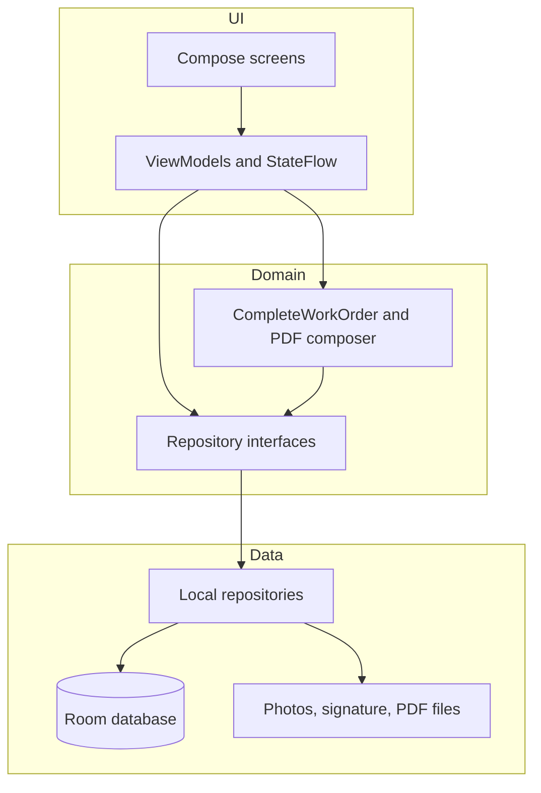

<p align="center">
  
</p>

<p align="center">
  A place notebook for people who work in the field, with work orders that end in a signed PDF.
</p>

<p align="center">
  <a href="https://github.com/TeebooTed/pushpyns/actions/workflows/android.yml"></a>
  <a href="LICENSE"></a>
  
  
  
</p>

Pushpyns started in 2016 as a small Android and iOS idea: save a place, share it, and, for a field business, close the job with the customer's signature. The original service is gone. This repository is that idea rebuilt as a modern, open-source Android app. Version 1 keeps everything on the phone. The data layer is shaped so cloud sync, accounts, and Play Billing can land later without throwing the screens away.

A **pyn** is a saved place. A **work order** is a job at a place. Pro, for now, is a local preview switch, not a charge.

## Features

- Local profile: your name, a business name, and whether you use the app for personal places, field work, or both. No account server.
- Home map on the current location. With no Google Maps key, a coordinate preview still plots your pyns. With a key, the same screen is a Google map.
- Pyns with address, coordinates, notes, categories, and up to eight photos from the camera or the gallery.
- Your own categories, plus a starter set (Business, Personal, Dining, Camping, Hiking, Work site).
- Search, and sort by category, name, date, or distance.
- Share a pyn as text, or hand the coordinates to Google Maps for directions.
- Work orders: customer, address, notes, optional line items and photos, and an optional link to a pyn. You can also save the job's address as a new pyn.
- Close a job by reading terms, capturing a signature, and sharing a PDF (business name, job, charges, photos, signature, time) through the Android share sheet.
- Material 3 light and dark themes, with an optional dynamic-color switch. The default palette stays Pushpyns blue.
- **Load sample places** drops four public demo spots on the map so a fresh install is not empty.

## Screenshots

Real captures are not in the repo yet. A headless render produced a black frame, so this table is a placeholder, not a picture of the app.

| Screen | What you would see | Status |
| --- | --- | --- |
| Home map | Current address, preview or Google map, nearby pyns, **New pyn here** | Help wanted |
| Pyn list | Search, sort chips, expandable rows | Help wanted |
| Pyn detail | Map header, address, share, Get Directions | Help wanted |
| New pyn | Form, category chips, camera and gallery | Help wanted |
| Work order | Customer, address, line items, photos, link to a pyn | Help wanted |
| Signature | Terms checkbox, then the signature pad | Help wanted |
| Signed PDF | Completed summary and **Share PDF** | Help wanted |

**Help wanted: screenshots.** Run the debug build on an emulator, shoot those seven screens, and put the PNGs in `docs/images/`. See [good first issue 10](docs/GOOD_FIRST_ISSUES.md). Please do not substitute mockups or generated pictures.

## Architecture

Screens collect state from ViewModels. ViewModels depend on repository interfaces, not on Room. The current implementations are local. A sync worker can implement the same interfaces later.



The seams to keep stable are `PynRepository`, `WorkOrderRepository`, `ProfileRepository`, `CategoryRepository`, `ProAccess`, and `WorkOrderPdfWriter` in `app/src/main/java/com/pushpyns/domain/repository/Repositories.kt`.

## Tech stack

| Piece | Choice |
| --- | --- |
| Language | Kotlin 2.4 |
| UI | Jetpack Compose, Material 3, Navigation Compose |
| State | ViewModel + StateFlow |
| Storage | Room |
| DI | Hilt |
| Images | Coil |
| Maps | Maps Compose, key from the secrets Gradle plugin |
| Location | Fused Location Provider |
| PDF | `android.graphics.pdf.PdfDocument` |
| Style | ktlint, Android Studio code style |
| SDK | minSdk 26, compileSdk / targetSdk 37 (platform 37.2) |

## Quick start

Requirements: JDK 21, Android Studio (current stable), Android SDK platform 37.2.

```bash
git clone https://github.com/TeebooTed/pushpyns.git
cd pushpyns
```

Open the project root in Android Studio and let it use the Gradle wrapper.

A Maps key is optional. To enable the live map, add this to `local.properties` (that file is gitignored; do not commit it):

```
MAPS_API_KEY=your_key_here
sdk.dir=/path/to/Android/sdk
```

`secrets.defaults.properties` sets `MAPS_API_KEY=MISSING`, which the app treats as "no key" and shows the preview map.

```bash
./gradlew assembleDebug
./gradlew test
./gradlew ktlintCheck
```

Install `app/build/outputs/apk/debug/app-debug.apk` on a device or emulator running API 26 or newer. On first launch, enter your name. Work orders stay behind **Enable Pro preview** until you turn that on in the paywall or in Settings. The switch is stored on the device. It is not a purchase.

## Project structure

```
app/src/main/java/com/pushpyns/
  domain/     models, repository interfaces, distance, money, PDF content
  data/       Room, local repositories, location, files, PdfDocument writer
  ui/         Compose screens and ViewModels, one package per feature
  di/         Hilt modules
app/src/test/ unit tests and Compose tests (Robolectric)
```

One Gradle module, `:app`, on purpose. Split it when a second client (web, iOS) shares the domain module.

## Roadmap

- [x] Local pyns, categories, map, share, and directions
- [x] Work orders with terms, signature, and a shareable PDF
- [x] Pro preview flag and paywall screen, with no billing SDK
- [ ] Cloud sync of pyns and work orders
- [ ] Accounts, so more than one device can hold the same notebook
- [ ] Play Billing for the real Pro subscription
- [ ] Web dashboard for open and completed work orders
- [ ] iOS, likely by sharing domain code through Kotlin Multiplatform
- [ ] Assign a work order to someone else on a team
- [ ] Offline map tiles for job sites with poor service
- [ ] Internationalization, starting with the hardcoded snackbar strings
- [ ] Accessibility pass (TalkBack, contrast, 48dp targets)
- [ ] Tablet layouts, list and detail side by side
- [ ] Screenshot set in this README, and broader UI tests

## Contributing

Issues and pull requests are welcome. Read [CONTRIBUTING.md](CONTRIBUTING.md) for setup, the test commands, and how we write commits. The [Code of Conduct](CODE_OF_CONDUCT.md) applies to issues, pull requests, and any other project space.

Starter tasks, with the files to open, are listed in [docs/GOOD_FIRST_ISSUES.md](docs/GOOD_FIRST_ISSUES.md). Good first places to look:

- Move snackbar copy into `strings.xml`
- Add a time picker beside the work-order date
- Miles or kilometers in Settings
- TalkBack labels on the map, photos, and signature pad
- Real screenshots for the table above

Report security problems in private. See [SECURITY.md](SECURITY.md). Do not open a public issue for a leaked key.

## License

[Apache License 2.0](LICENSE). Copyright 2026 Matthew Nielsen.

## Credits

Pushpyns was imagined by Matthew Nielsen in 2016 as a place notebook for field work. This repository is a new implementation of that product: Kotlin and Jetpack Compose, not the original outsourced app, and not a copy of its server. The pin mark in the launcher and in `docs/images/wordmark.svg` carries the same blue pin forward.
